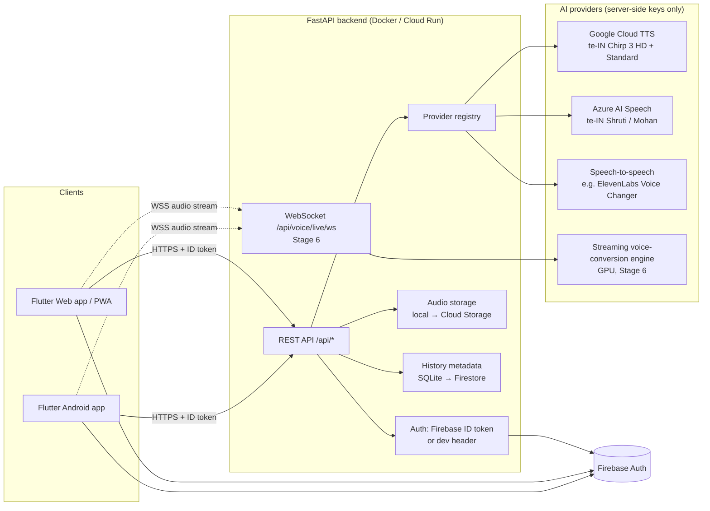

# Architecture – తెలుగు AI Voice (Telugu Voice Studio)

## 1. Overview



**Key rule:** the app never talks to an AI vendor directly and never contains a key.
Every AI call goes app → FastAPI → provider, so keys stay in server environment
variables or a secrets manager and vendors can be swapped without an app update.

## 2. Components

| Layer | Technology | Responsibility |
|---|---|---|
| App | Flutter (Material 3), one codebase for Android + Web/PWA | UI, Telugu input (in-app Telugu keyboard + system keyboard), recording, playback, history |
| API | Python FastAPI, Pydantic validation | Auth, validation, provider routing, file handling, signed download links |
| Auth | Firebase Authentication | Users sign in on the app; backend verifies ID tokens with `firebase-admin` |
| Metadata | SQLite (dev) → Firestore (Stage 7) | Audio history per user |
| Files | Local disk (dev) → Cloud Storage (Stage 7) | Audio blobs, never public |
| AI | Pluggable providers | TTS, recorded conversion, live streaming conversion |

## 3. Provider abstraction (no hard-coded voices or vendors)

`backend/app/providers/base.py` defines three small interfaces:

```python
class TTSProvider:              synthesize(SynthesisRequest) -> AudioPayload
class VoiceConversionProvider:  convert(ConversionRequest) -> AudioPayload
class LiveConversionProvider:   create_session(user_id, direction) -> LiveSessionInfo
```

* `registry.py` builds the active providers from environment variables
  (`TTS_PROVIDERS`, `VOICE_CONVERSION_PROVIDER`, `LIVE_CONVERSION_PROVIDER`).
* Each provider reports an honest **state**: `ready`, `not_configured` (keys missing),
  `not_implemented` (integration is a later stage) or `unsupported` (vendor can't do it).
* `GET /api/health` publishes those states; the app enables a button **only** when
  its feature is `ready`. Nothing pretends to work.
* Voices live in `backend/config/voices.yaml` – add or rename voices without code changes.

### Telugu voices in the catalog

| id | Vendor voice | Gender | Pitch control |
|---|---|---|---|
| google-te-female-hd | te-IN-Chirp3-HD-Kore | Female | No (Chirp 3 HD has no pitch parameter) |
| google-te-male-hd | te-IN-Chirp3-HD-Charon | Male | No |
| google-te-female-standard | te-IN-Standard-A | Female | Yes |
| google-te-male-standard | te-IN-Standard-B | Male | Yes |
| azure-te-female-shruti | te-IN-ShrutiNeural | Female | Yes (SSML prosody) |
| azure-te-male-mohan | te-IN-MohanNeural | Male | Yes (SSML prosody) |

**Accents:** Google and Azure publish one general Telugu (te-IN) accent today.
Separate Telangana and Andhra accent voices are **not available** from either, so the
app labels the accent "standard" instead of offering a fake choice. A custom-trained
voice could add them later through the same catalog.

**Styles:** neither provider currently offers speaking styles for Telugu voices; the
style picker appears automatically if a catalog voice lists `styles`.

### Long Telugu paragraphs

`services/text.py` NFC-normalises text (keeping ZWNJ/ZWJ, which change how Telugu
conjuncts render), then splits long text into provider-sized chunks on sentence
boundaries, then word boundaries, and never between a consonant and its vowel sign
or after a virama (్). Google's limit is in **bytes**, and each Telugu letter is 3
bytes in UTF-8, so chunking is by byte budget. Chunks are synthesised and joined in Stage 3.

## 4. Data model

```
AudioRecord
  id               uuid hex
  owner_id         Firebase uid (or "dev:<name>" in dev mode)
  kind             tts | original | converted
  title            from text / file name (sanitised)
  format, mime     detected from file bytes, never from the file name
  size_bytes, duration_seconds
  created_at       UTC ISO-8601
  storage_key      <sha256(owner)[:24]>/<id>.<ext>
  source_audio_id  converted → its original
  parameters       voice, speed, pitch, direction, provider, consent
```

## 5. Security model

| Requirement | How it is met |
|---|---|
| No keys in the app | All vendor keys are server env vars (`backend/.env`, or Secret Manager in production) |
| Authenticated users | Firebase ID token verified on every protected endpoint; dev header mode is refused when `APP_ENV=production` |
| Private audio | Every query is scoped to the caller's uid; other users' ids return 404 |
| Downloads without leaking auth | HMAC-signed links that expire (default 15 min) |
| Upload safety | Size cap (rejected early via Content-Length, then while reading), magic-byte format detection, full parse with `mutagen`, duration cap, random storage names, path-traversal guard |
| Input validation | Pydantic models + Telugu text checks; uniform JSON errors |
| HTTPS | Terminated by Cloud Run / nginx / load balancer; HSTS header in production; Android release builds block cleartext |
| Headers | `nosniff`, `X-Frame-Options: DENY`, `Referrer-Policy: no-referrer` |
| Consent / impersonation | Conversion and live endpoints require `consent=true`; consent recorded with the item; UI states the no-impersonation rule |
| Microphone | Requested only when the user starts recording (Stage 4) |

## 6. Live conversion (Stage 6) – honest design

Live male↔female conversion needs a **real-time speech-to-speech model**. Plain pitch
shifting sounds robotic and does not change vocal identity, so it is not used.

Planned pipeline: app captures 16 kHz PCM → WebSocket `/api/voice/live/ws/{session}` →
backend relays to a streaming conversion engine (typically a self-hosted
RVC-style model on a GPU; target: well under half a second of added delay) → converted PCM streams back
→ played to headphones. If no streaming engine is configured, `/api/health` reports
`live_conversion.available=false` and the app keeps Start disabled with an explanation.

Hosted vendors checked during Stage 1: ElevenLabs offers WebSocket streaming for
text-to-speech and its agents platform, and its Voice Changer works on recorded files;
that suits Stages 4–5 but is not a live microphone stream. The final engine choice for
Stage 6 will be confirmed against vendor docs at that stage.

## 7. Folder structure

```
telugu-ai-voice/
├── README.md                 setup, run, build, feature status
├── docker-compose.yml        API + nginx serving the web build
├── deploy/nginx.conf         same-origin web + /api proxy (+ WebSocket upgrade)
├── docs/
│   ├── ARCHITECTURE.md       this file
│   └── API.md                endpoint reference
├── backend/
│   ├── Dockerfile, .dockerignore, .env.example
│   ├── requirements.txt, requirements-dev.txt, pyproject.toml
│   ├── config/voices.yaml    Telugu voice catalog
│   ├── app/
│   │   ├── main.py           app factory, CORS, security headers, upload guard
│   │   ├── schemas.py        request/response models
│   │   ├── core/             config, auth, errors, signed links
│   │   ├── providers/        base interfaces, registry, voice catalog
│   │   ├── services/         audio validation, storage, history repository, Telugu text
│   │   └── api/              deps + routes (health, tts, voice, audio)
│   └── tests/                pytest suite
└── app/                      Flutter (Android + Web/PWA)
    ├── pubspec.yaml, analysis_options.yaml
    ├── assets/fonts/         Noto Sans + Noto Sans Telugu (OFL)
    ├── web/                  index.html, manifest.json, icons (PWA)
    ├── tool/setup_android.dart   permissions + app name after `flutter create`
    ├── lib/
    │   ├── main.dart, app.dart
    │   ├── core/             api client + models, config, routing, state, theme, feature status
    │   ├── widgets/          waveform, mic illustration, feature card, Telugu keyboard, common UI
    │   └── features/         home, tts, convert, live, history, settings, shell
    └── test/widget_test.dart
```

## 8. Build stages

| Stage | Scope | Status |
|---|---|---|
| 1 | Architecture, folder structure, provider design | **Done** |
| 2 | Full UI + navigation; backend with all endpoints, auth, validation, upload/history | **Done** |
| 3 | Google + Azure Telugu TTS, in-app player, Firebase sign-in in the app | Next – needs Google Cloud / Azure keys and a Firebase project |
| 4 | Microphone recording + male→female conversion | Needs a speech-to-speech provider key |
| 5 | Female→male conversion | Same provider as Stage 4 |
| 6 | Live streaming conversion | Needs a streaming engine (GPU host or vendor) |
| 7 | Cloud Storage + Firestore history, share sheet | Needs Firebase project |
| 8 | Hardening, rate limits, CI, deployment, release APK signing | — |

## Personal voice cloning (added in 0.5)

```
Flutter  CloningScreen ─┬─ LocalCloneService  ── FreeVoiceEngine ── IndicF5 Space (Hugging Face)
 (Create / My Voices /  │     profiles + samples + consent on the phone
  Text to Speech)       └─ ServerCloneService ── /api/clone/* ── CloneRegistry ─┬─ IndicF5CloneProvider (+HF_TOKEN)
                                                                                ├─ SarvamCloneProvider  (SARVAM_API_KEY)
                                                                                └─ ElevenLabsCloneProvider (ELEVENLABS_API_KEY)
                                    SQLite: voice_profiles, clone_generations, audio_items
```

* One interface on each side (`CloneService` in the app, `VoiceCloneProvider` on the server), so a
  provider is added by writing one class and one line in `CLONE_FACTORIES`.
* A profile always stores the speaker's own sample and a consent record. Category (female/male) is a
  label only; nothing converts one gender into another by pitch.
* Zero-shot providers (IndicF5) keep the sample and send it with each request; saved-voice providers
  (Sarvam, ElevenLabs) store a provider voice id, which is deleted with the profile.

### Planned on this base (not implemented yet – the app does not offer them)

| Future feature | How it plugs in |
|---|---|
| Voice-to-voice in a saved voice | `VoiceConversionProvider` with the profile as target (ElevenLabs speech-to-speech with the cloned `voice_id`, or Seed-VC with the stored sample). |
| Real-time male↔female / live conversations | `LiveConversionProvider` + `/api/voice/live/session` WebSocket, only with a genuine streaming engine (e.g. a GPU server running a streaming VC model). Until then the Live screen stays *Unavailable*. |
| Telugu conversational assistant | Speech-to-text (e.g. Sarvam Saarika) → LLM → `POST /api/clone/tts` with the user's chosen voice. |
| More personal profiles | Already supported (`MAX_VOICE_PROFILES`). |
| WhatsApp sharing, MP3/WAV downloads | Done: Android share sheet; `?format=mp3` on signed links. |
